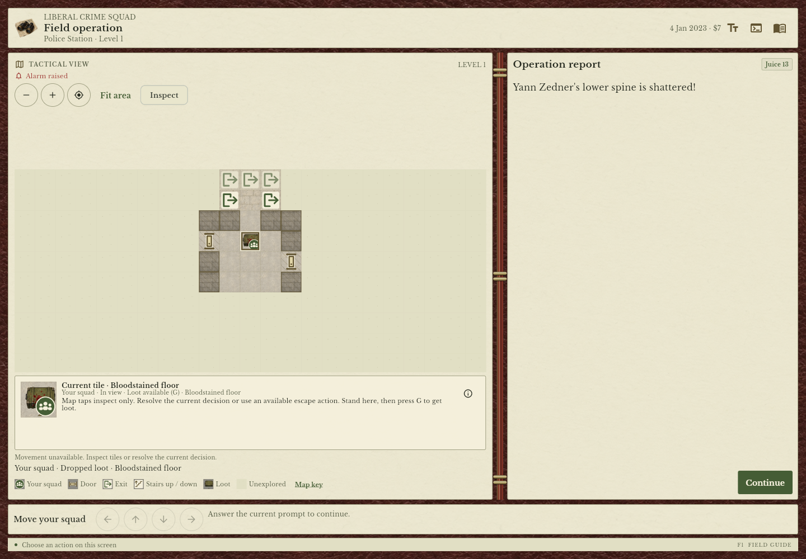
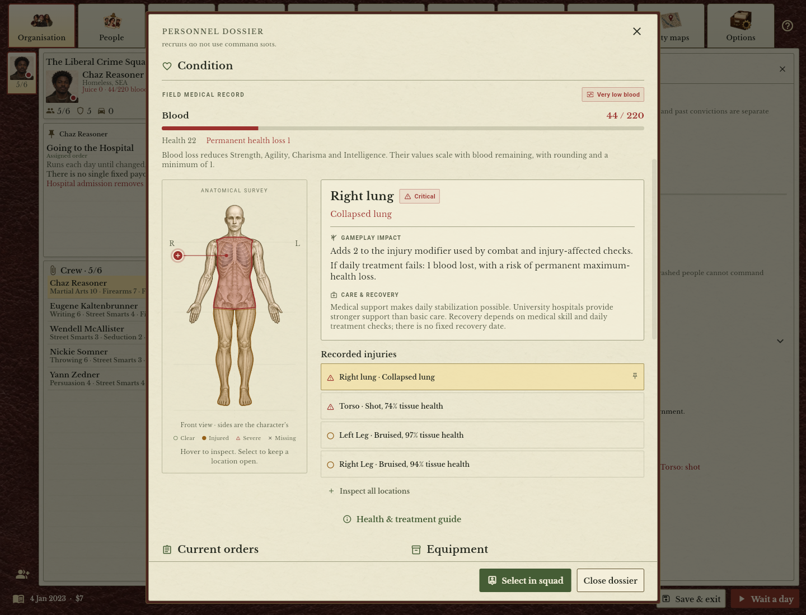

# LCS: New Age — The Underground Edition

A work-in-progress fork of [Liberal Crime Squad: New Age](https://github.com/ashley-s-fox/lcs-new-age), with an interface inspired by the old organiser in **Gangsters: Organized Crime**. Paper and leather, painted portraits, crew dossiers, city maps and job cards—with the New Age game underneath.

## Screenshots

*A police-station firefight: follow the squad's attacks and the consequences in the field journal.*

*The aftermath: inspect wounds, blood loss and a collapsed lung in the personnel dossier.*

Screenshots are captured in-game using disposable review campaigns; the injury example uses prepared wounds.

## Why this exists

I'm Kevin Wood. I contributed a few small features and bug fixes to LCS years ago. I've still got emails with Jonathan from 2009, which is slightly terrifying! Finding the Flutter version blew me away and got me tinkering again. It's lovely to see familiar names still keeping LCS going.

The game always reminded me a little of Gangsters: Organized Crime, so I started this vibe-coded fork to explore that style of interface. It's still very much a work in progress, and feedback is welcome.

## What's changed

- A paper-and-leather journal for managing your organisation, crew and orders, keeping your place when you switch people.
- Painted portraits, crew dossiers, city maps and job cards explaining assignments.
- Choose your founder’s portrait; characters keep their faces across saves, with supported injuries and equipment reflected visually.
- Bug fixes along the way, including crafting consuming cloth when you couldn't afford the job, and fixes to save importing and recovery.

The interface and artwork are being developed with AI assistance; the paintings and portraits are AI-generated. The project builds on Ashley S. Fox's New Age and the work of the wider LCS community.

## Playing

**[Play the latest nightly in your browser](https://woodk123.github.io/lcs-underground-edition/)** — no installation or account required. This is a development build, updated automatically after successful nightly publication. Saves belong to your browser profile on this site; export important campaigns before clearing browser data or switching devices. Downloaded browser players use separate save storage; use export/import to transfer a campaign.

[Hosted build source and credits](https://woodk123.github.io/lcs-underground-edition/source.html) includes the exact matching source download for the version currently online.

The **[0.1.0 release](https://github.com/woodk123/lcs-underground-edition/releases/tag/underground-v0.1.0)** includes field operations, injury dossiers, dedicated campaign-management pages and Linux support. Download a player ZIP and extract the whole folder:

- **[Windows player ZIP](https://github.com/woodk123/lcs-underground-edition/releases/download/underground-v0.1.0/LCS-Underground-Edition-underground-v0.1.0-Windows-x64-Player.zip)** — Windows 10/11 (64-bit). Double-click **lcs_new_age.exe**; no Python or Flutter needed.
- **[Linux x64 player ZIP](https://github.com/woodk123/lcs-underground-edition/releases/download/underground-v0.1.0/LCS-Underground-Edition-underground-v0.1.0-Linux-x64-Player.zip)** — Ubuntu 22.04 or compatible, with GTK 3. Run **./lcs_new_age**; keep `lib/` and `data/` alongside it.
- **[Browser player ZIP](https://github.com/woodk123/lcs-underground-edition/releases/download/underground-v0.1.0/LCS-Underground-Edition-underground-v0.1.0-Web-Player.zip)** — double-click **Play.cmd**. Requires Python 3; opens **http://127.0.0.1:8765/**.

The **[matching source ZIP](https://github.com/woodk123/lcs-underground-edition/releases/download/underground-v0.1.0/LCS-Underground-Edition-underground-v0.1.0-Source.zip)** is a separate download for building or modifying the game. See [build instructions](docs/BUILDING.md). If you redistribute a player ZIP, keep its matching source available alongside it under GPL v2.

**Keep the same browser profile and address to keep using your browser saves.** `localhost`, another port or another browser has separate save storage. Export important saves from the game before clearing browser data.

Windows and browser saves are separate. Use the game's export/import controls to transfer a campaign between them.

**[Nightly builds](https://github.com/woodk123/lcs-underground-edition/releases?q=nightly-)** provide automatically checked Windows, Linux x64 and browser players when code or build inputs change. These are development prereleases; export important saves before trying them. The numbered release above remains available separately. See [nightly build details](docs/BUILDING.md#nightly-builds-on-github) and [workflow status](https://github.com/woodk123/lcs-underground-edition/actions/workflows/nightly.yml).

## More information

- [Building and development](docs/BUILDING.md)
- [Development lessons and working practices](docs/DEVELOPMENT_LESSONS.md)
- [Architecture](docs/ARCHITECTURE.md)
- [Testing](docs/TESTING.md)
- [Changes and bug fixes](docs/ORIGINAL_CODE_CHANGES.md)
- [Versioning and releases](docs/VERSIONING.md)
- [Artwork and assets](docs/ASSETS.md)
- [Portrait library](docs/PORTRAIT_LIBRARY.md)

## Credits and license

The Underground Edition by **Kevin Wood**.

Based on [Liberal Crime Squad: New Age by Ashley S. Fox](https://github.com/ashley-s-fox/lcs-new-age), itself built on the original Liberal Crime Squad. Thanks to everyone who has kept the game alive over the years.

See [AUTHORS.md](AUTHORS.md) for the original credits. Distributed under the [GNU GPL v2](LICENSE).
