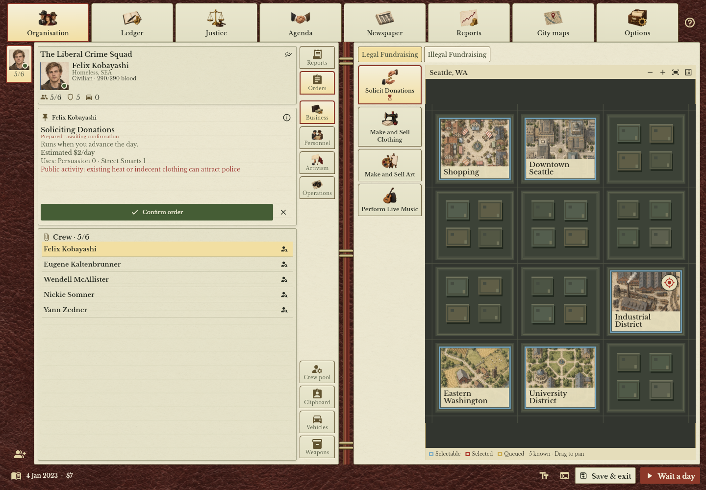
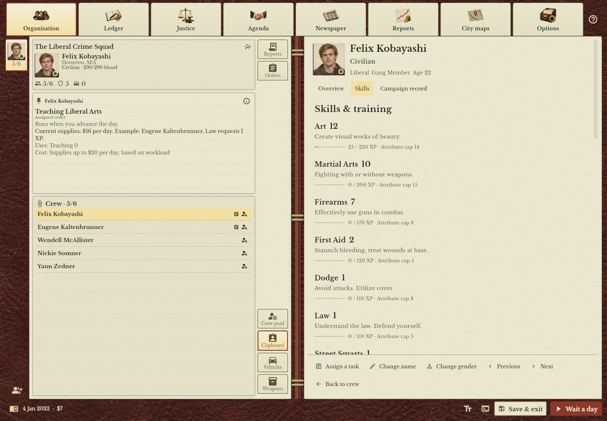

# LCS: New Age — The Underground Edition

A work-in-progress fork of [Liberal Crime Squad: New Age](https://github.com/ashley-s-fox/lcs-new-age), with an interface inspired by the old organiser in **Gangsters: Organized Crime**. Paper and leather, painted portraits, crew dossiers, city maps and job cards—with the New Age game underneath.

## Screenshots

*The organisation journal: manage your crew, review job cards and explore the city.*

*Character dossiers bring portraits, skills and campaign records together.*

## Why this exists

I'm Kevin Wood. I contributed a few small features and bug fixes to LCS years ago. I've still got emails with Jonathan from 2009, which is slightly terrifying! Finding the Flutter version blew me away and got me tinkering again. It's lovely to see familiar names still keeping LCS going.

The game always reminded me a little of Gangsters: Organized Crime, so I started this vibe-coded fork to explore that style of interface. It's still very much a work in progress, and feedback is welcome.

## What's changed

- A paper-and-leather journal for managing your organisation, crew and orders.
- Painted portraits, crew dossiers, city maps and job cards explaining assignments.
- Choose your founder’s portrait; characters keep their faces across saves, with supported injuries and equipment reflected visually.
- Bug fixes along the way, including crafting consuming cloth when you couldn't afford the job, and fixes to save importing and recovery.

The interface and artwork are being developed with AI assistance; the paintings and portraits are AI-generated. The project builds on Ashley S. Fox's New Age and the work of the wider LCS community.

## Playing

The **[early preview release](https://github.com/woodk123/lcs-underground-edition/releases/tag/underground-preview-2026.10.15)** is ready to try. Download a player ZIP and extract the whole folder:

- **[Windows player ZIP](https://github.com/woodk123/lcs-underground-edition/releases/download/underground-preview-2026.10.15/LCS-Underground-Edition-2026.10.15-Windows-x64-Player.zip)** — Windows 10/11 (64-bit). Double-click **lcs_new_age.exe**; no Python or Flutter needed.
- **[Browser player ZIP](https://github.com/woodk123/lcs-underground-edition/releases/download/underground-preview-2026.10.15/LCS-Underground-Edition-2026.10.15-Web-Player.zip)** — double-click **Play.cmd**. Requires Python 3; opens **http://127.0.0.1:8765/**.

The **[matching source ZIP](https://github.com/woodk123/lcs-underground-edition/releases/download/underground-preview-2026.10.15/LCS-Underground-Edition-2026.10.15-Source.zip)** is a separate download for building or modifying the game. See [build instructions](docs/BUILDING.md). If you redistribute a player ZIP, keep its matching source available alongside it under GPL v2.

**Keep the same browser profile and address to keep using your browser saves.** `localhost`, another port or another browser has separate save storage. Export important saves from the game before clearing browser data.

Windows and browser saves are separate. Use the game's export/import controls to transfer a campaign between them.

**[Nightly builds](https://github.com/woodk123/lcs-underground-edition/releases?q=nightly-)** provide the latest automatically checked Windows and browser builds when code or build inputs change. These are development prereleases; export important saves before trying them. The early preview above remains a separate release. See [nightly build details](docs/BUILDING.md#nightly-builds-on-github) and [workflow status](https://github.com/woodk123/lcs-underground-edition/actions/workflows/nightly.yml).

## More information

- [Building and development](docs/BUILDING.md)
- [Architecture](docs/ARCHITECTURE.md)
- [Testing](docs/TESTING.md)
- [Changes and bug fixes](docs/ORIGINAL_CODE_CHANGES.md)
- [Artwork and assets](docs/ASSETS.md)
- [Portrait library](docs/PORTRAIT_LIBRARY.md)

## Credits and license

The Underground Edition by **Kevin Wood**.

Based on [Liberal Crime Squad: New Age by Ashley S. Fox](https://github.com/ashley-s-fox/lcs-new-age), itself built on the original Liberal Crime Squad. Thanks to everyone who has kept the game alive over the years.

See [AUTHORS.md](AUTHORS.md) for the original credits. Distributed under the [GNU GPL v2](LICENSE).
