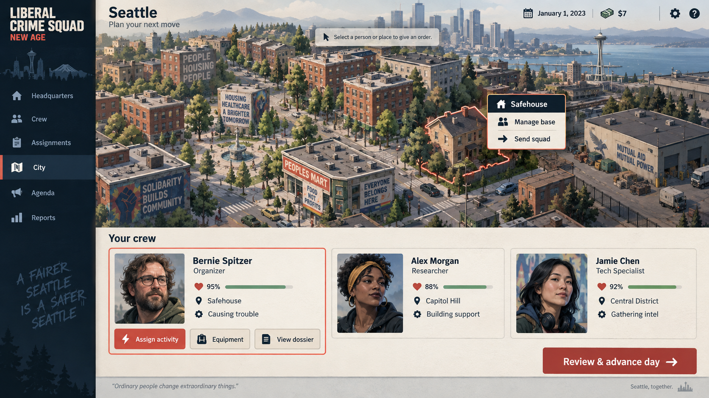

# Gangsters interface research — superseded initial direction

The 14 October user request explicitly requires the first **Gangsters: Organized Crime** organisation, squad selection and activity layout. The current specification is [GANGSTERS_MANUAL_AUDIT.md](GANGSTERS_MANUAL_AUDIT.md), based on all 104 pages of the owned manual, and [GANGSTERS_VISUAL_SPEC.md](GANGSTERS_VISUAL_SPEC.md). The journal implementation and final evidence are recorded in [GANGSTERS_JOURNAL_ACCEPTANCE.md](GANGSTERS_JOURNAL_ACCEPTANCE.md).

The earlier recommendations below are historical. In particular, the earlier instruction to avoid the period journal, the immediate assignment interaction and the proposed modern full-width roster were superseded. The delivered design uses an open leather journal, eight illustrated tabs, vertical squad tabs, a selected crew page, the facing pool/map, near-binding group/task rails and a pinned Confirm/Cancel job card. Source LCS rules still govern capacity, timing, skills and costs.

---

## Historical initial city and crew direction

Research date: 13 October 2026. This records the user's design steer: modern management UI with direct selection in the central workspace, inspired by *Gangsters: Organized Crime*.

The playable build now implements central clickable crew/task rows and a city operations board with an equivalent locations list. Both use the original engine's real people, destinations and restrictions. The generated concept below remains illustrative; additional portraits and the proposed planning-desk/day-review layout are future art/design ideas, not shipped mechanics.

## Recommendation

Make people and places the controls. A crew member should be a large, readable card or row; clicking that card should open their assignment/dossier in the same workspace. A site should be a selectable map marker or location card with its own available operations. Remove the detached **Available choices** rail, ASCII column rules, giant terminal-derived heading, and duplicated letter commands from modern screens. Keep the original engine's actions, checks and depth behind these controls.

The useful Gangsters influence is ownership of a living city and named crew, with orders attached to those objects. Its miniature icon bars, overlapping windows and hard-to-read notebook typography would recreate the usability problem.

## Actual reference screens

The links below come directly from the [official GOG product gallery](https://www.gog.com/en/game/gangsters_organized_crime). Each was visually inspected in the background browser; the original game was not launched or controlled. External screenshots are reference material only and must not be bundled as game assets.

| Reference | What is visible | Useful translation for LCS |
|---|---|---|
| [City overview / planning desk](https://images.gog-statics.com/3533c05cbdaf185b12c95615d641923a55b870b25700bdca828b787322bb104d_product_card_v2_mobile_slider_639.jpg) | The city occupies almost the whole notebook, with blocks and notable-site markers. | Make the central city/district view useful for selecting known LCS sites; keep selected location, occupants and actions together. |
| [Crew dossier and recruitment](https://images.gog-statics.com/a8d96efbfc4db0c7d539eeb03adc039f8d7c2fc5bd71a5c14c4411c4f42d6c7d_product_card_v2_mobile_slider_639.jpg) | Named portraits, skill ratings, pay and a visible list of recruits. | Use crew cards with recognizable identity, health, location and current assignment. Reveal full skills and equipment through the selected card. |
| [Roster identity and selection](https://images.gog-statics.com/757408eeb324807ca82c3b06541d4eebbae2f18fed2ab9efb5ce699af2133d61_product_card_v2_mobile_slider_639.jpg) | A selected profile and name list, with portrait and object-related controls. | Maintain a visible selected person, then show exactly whose action is being changed. Avoid letter-to-name translation. |
| [Building details in the city](https://images.gog-statics.com/031c1e2082705a45b50c942a005d9b9ba6405acd7180cefcaab09b38692ce69e_product_card_v2_mobile_slider_639.jpg) | Isometric blocks, an information panel with profit/value/security, and tracked character windows. | Attach useful status and consequences to a clicked place. A list/card alternative should offer the same site information without requiring map hunting. |
| [Street event context](https://images.gog-statics.com/ce7caf3cc266dbcfb5ce6193fc31aec3a5e8f3201426aabbdd19a572d68f9686_product_card_v2_mobile_slider_639.jpg) | The city fills the screen; a report identifies a person and the exact street corner. | Reports should link back to the relevant squad, person or place. Show what changed and what the player can do next. |

The original local manual at `D:\Programming\Gangsters\original-local\Manual.pdf` was also inspected read-only. Relevant evidence: pp. 55–57 describe map overlays, directly investigating buildings and commands belonging to the building; p. 78 keeps a crew member's name and order in the same tracked window; p. 81 selects movement targets in the city; p. 97 describes shortcuts as a complement to mouse actions. These are interface precedents, not mechanics to transplant into LCS.

## Three concrete screens

### 1. Crew and daily assignments — implement first

The central panel is a roster with full-width clickable cards/rows: identity, health, best relevant skill, current location and activity. Clicking Bernie opens **Bernie Spitzer · Assign activity** in the center. The next view groups the actual engine choices into readable action cards and explains relevant restrictions/costs. Choosing an activity updates Bernie's visible assignment immediately. Sorting, search and bulk assignment sit above the roster; previous/next appear only when meaningful. A contextual Back button returns to the roster. The right choice rail disappears.

This directly fixes the screenshot the user rejected and is valuable before a spatial city screen exists. Use clean sans-serif typography and labeled fields; do not render the old terminal row as a styled paragraph.

### 2. City / operations board

An illustrated Seattle district view fills the central workspace, with UI-rendered markers for real known engine locations. Select a place, see its name, risk, known information and relevant operations attached to that selection. Give a squad an order from that place. Offer an equally capable searchable Locations list for accessibility and large campaigns. At narrow widths, the selected-site details become an inline card below the map.

The illustration must not invent simulated streets, territorial control or travel rules absent from the LCS engine. Marker positions are a presentation of existing locations; labels, selection, state and actions stay in code.

### 3. Planning desk / day review

The middle holds assignment cards grouped by squad or person, plus a short ledger of known costs and changes. Click a person to edit their task or a site to change the destination. Resolve missing or invalid orders where they occur. A persistent **Review & advance day** control opens a clear review of known consequences before the existing engine advances time. Reports then present changes with links to affected objects.

Keep this screen honest: do not display predicted money, success probabilities, travel times or danger ratings unless the game supplies them. Use explanatory copy when the outcome is unknown.

## Original generated concept

This is a visual proposal, **not a runtime screenshot**. It shows the chosen spatial hierarchy and direct actions on the selected safehouse and crew member. Faces, additional crew, health values, building arrangements and some labels are illustrative. Do not ship those fabricated values or a rasterized UI in the playable build.

Art direction: contemporary Seattle, editorial painted isometric architecture, readable neutral sans-serif type, warm paper, dark blue-black ink, muted teal, vermilion only for selection/primary actions. Dossier details provide atmosphere while content remains uncluttered. Keep existing city panorama and safehouse art stylistically consistent with this direction. Avoid fedora/1920s dressing: the inspiration is the management experience, while LCS retains its own era, satire and systems.

Production asset ideas: text-free district panorama tiles; text-free safehouse/courthouse/media/industrial site vignettes; a consistent portrait treatment; subtle dossier backplates. All interactive labels, health displays, menus and selection borders should be rendered by the application. Generated art should not contain semantic text or create fake playable locations.

## Usability acceptance checks

- The person or place displayed in the center is itself clickable; its primary action is in that same object or selected detail view.
- A player can assign a task without reading or matching a letter to a name elsewhere.
- No modern screen depends on a duplicate right-hand **Available choices** menu.
- Names, current activity, health and location remain readable and labeled without ASCII alignment or monospace table padding.
- Keyboard focus, Enter/Space activation and Escape/Back remain available; shortcuts are secondary hints.
- Selected state, completed assignment and invalid action feedback are visible where the action occurred.
- Screen readers and the location list provide a usable path without identifying buildings by artwork alone.
- The interface exposes the engine's full available actions, rather than silently dropping uncommon choices for visual simplicity.

## Generation provenance

- Tool: built-in ChatGPT `image_gen.imagegen`, `ui-mockup`, one generation, opaque background.
- Prompt: `assets/concepts/city-crew-command-concept-v1.prompt.txt` (verbatim full prompt).
- Output: `assets/concepts/city-crew-command-concept-v1.png`, 1672 × 941 pixels.
- Original output retained: `C:\Users\sheer\.codex\generated_images\01a136eb-c66f-7340-bf3d-49a84d72d100\exec-594c1cb9-586a-46fe-ba81-b881f4f4e5af.png`.
- Inputs: text prompt only. No Gangsters image, copyrighted sprite or external screenshot was supplied to the generator. No CLI/API fallback was used.
- Status: concept/reference only, intentionally outside `upstream/assets/modern`; not included in runtime asset manifests.
